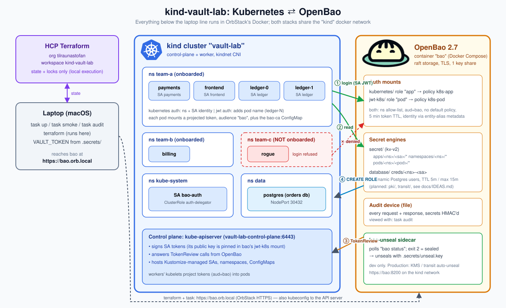
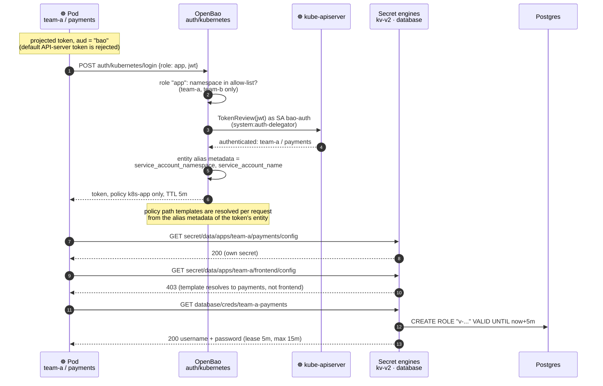
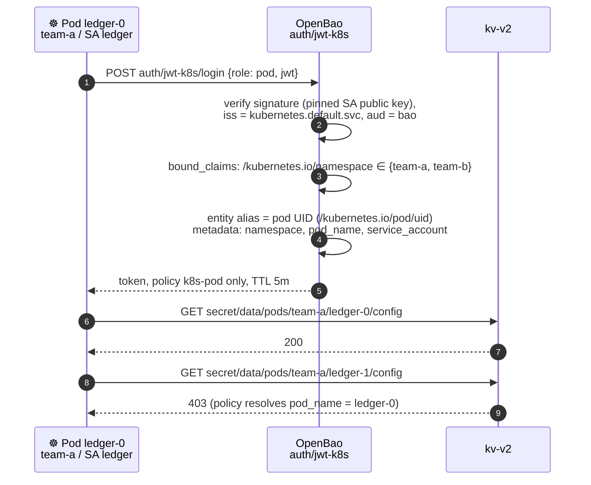
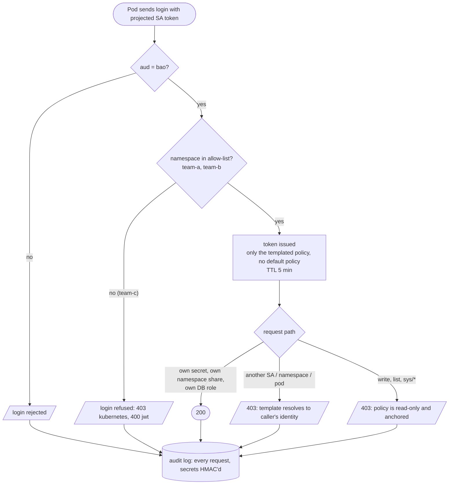
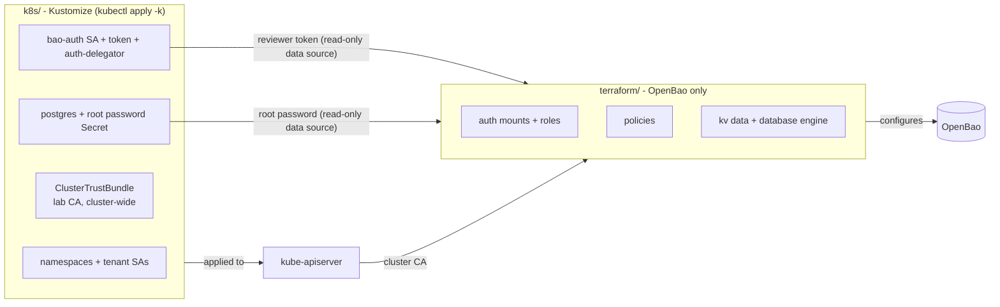
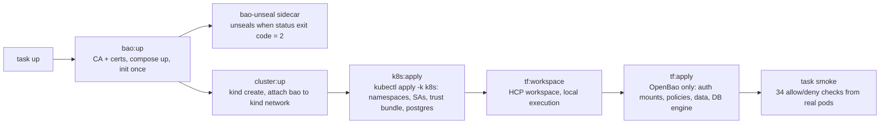

# Diagrams

Mermaid renders natively on GitHub. The overview is an SVG with the official Kubernetes and OpenBao logos
(embedded, so it works as a plain ``); logo sources are in `images/logos/`.

## Architecture

Three addresses reach the same OpenBao: the laptop uses `https://bao.orb.local` (OrbStack HTTPS), pods use
`https://bao:8200` (lab CA), and OpenBao calls the API server at `https://vault-lab-control-plane:6443`.
That only works because the `bao` container is attached to the `kind` docker network.

## 1. `kubernetes` auth: namespace + service account

## 2. `jwt` auth: adds the pod name

The `kubernetes` method cannot see the pod name; projected tokens carry it as a claim, so the JWT is validated
locally against the API server's pinned public key. No call to the API server is made.

## 3. Where a request is stopped

## 4. Who owns what: Kustomize vs Terraform

## 5. Bootstrap and startup

